# Diagrama completo de classes — Além do Equilíbrio

O arquivo [diagrama-classes.dot](diagrama-classes.dot) marca **todos os 22 requisitos** nos nós correspondentes.
O [índice](indice-22-itens-poo.md) apresenta cada item, classe, método e justificativa.

```mermaid
classDiagram
direction LR
namespace core {
class ElectricPhysics
class GameController
class GameState
class Main
class MainMenuController
class ResourceManager
class SaveFormatException
class SaveManager
class SceneRouter
}
namespace game {
class Ability
class AbilityBook
class AbilityRegistry
class BattleController
class BattleView
class BossEnemy
class CameraTestOverlay
class ChapterCompleteView
class ChapterProgress
class ChargeType
class ChargedEnemy
class CollisionManager
class CorruptedDipole
class Damageable
class DebugGridRenderer
class DialogueController
class DialogueLine
class DialogueRepository
class Enemy
class EquipotentialShield
class ExplorationController
class ExplorationZone
class FieldImpulse
class GameCharacter
class GameRegistry
class HUD
class Hero
class HeroView
class InsulatorTrailLayout
class Interactable
class KnowledgeTopic
class MapEnemySpawner
class Merchant
class Movable
class NPC
class PhysicsQuestion
class PrologueController
class QuestionBank
class QuizController
class QuizProvider
class RepulsionPulse
class SceneryInteractable
class TileMapRenderer
class UncontrolledCharge
class UnstableConductor
class WanderingSpark
class WorldObject
class ZoneManager
class CombatScenarioChecks
class PersistenceScenarioChecks
class PooRubricChecks
class BattleController_BattleResult
class BattleController_BattleTurn
class BattleView_PixelIconType
class BossEnemy_Phase
class BossEnemy_FieldDirection
class HeroView_Direction
class MapEnemySpawner_MapEnemyNode
class TileMapRenderer_ZoneTheme
}
GameCharacter <|-- Hero
GameCharacter <|-- Enemy
GameCharacter <|-- NPC
Enemy <|-- WanderingSpark
Enemy <|-- ChargedEnemy
Enemy <|-- UnstableConductor
Enemy <|-- BossEnemy
ChargedEnemy <|-- UncontrolledCharge
ChargedEnemy <|-- CorruptedDipole
NPC <|-- Merchant
Ability <|-- RepulsionPulse
Ability <|-- FieldImpulse
Ability <|-- EquipotentialShield
Damageable <|.. Hero
Movable <|.. Hero
Damageable <|.. Enemy
Interactable <|.. NPC
Interactable <|.. WorldObject
Interactable <|.. SceneryInteractable
QuizProvider <|.. Merchant
Hero *-- AbilityBook : composição 4
```

O diagrama DOT contém as associações adicionais de controle, exploração, batalhas, persistência e recursos.
Estão representados 68 tipos do projeto, inclusive as classes dos testes e tipos internos.
Para gerar o PDF do diagrama: `dot -Tpdf docs/diagrama-classes.dot -o docs/diagrama-classes.pdf`.
